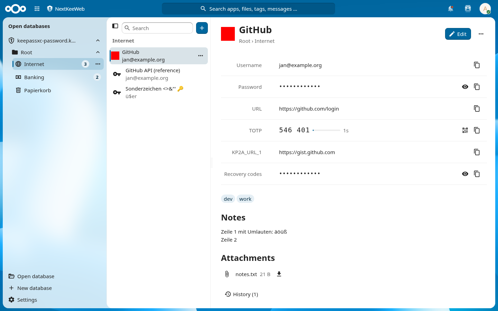

# KeeNext

> **Alpha.** KeeNext is early software and has not been independently audited. It is provided as is, without warranty and without liability (AGPL-3.0, sections 15 and 16). Keep your own backups of every database you open with it, and do not make it the only copy of your passwords or the only way to reach them.

A Nextcloud app (id `keenext`) for opening and editing KeePass databases (`.kdbx`) stored in Nextcloud, compatible with KeePassXC, KeePass and KeePassDX.

- Databases are decrypted in the browser. The server stores and serves the encrypted file; it never receives the master password, key files or decrypted contents.
- Clicking a `.kdbx` file in the Files app opens it here; Files' "New" menu creates databases. Inside the app, databases are opened with the Nextcloud file picker or from the list of recently opened ones, which also remembers the key file used.
- Changes made elsewhere while a database is open (KeePassXC through the desktop client, another browser tab) are merged rather than overwritten.
- KDBX 3.1 and 4.x, Argon2d/Argon2id and AES-KDF, AES-256, ChaCha20 and Twofish, password and/or key file.
- Import from CSV (KeePassXC, Bitwarden, browsers …), Bitwarden JSON, KeePass XML and other `.kdbx` files; export as KeePass XML or CSV.
- Health check (weak, reused, expiring passwords) with an opt-in Have I Been Pwned lookup; TOTP with QR codes.



What is covered compared to KeePassXC, and what is not yet: [docs/features.md](docs/features.md). How the code is organised: [docs/architecture.md](docs/architecture.md). The KDBX library is [`@keenext/kdbxweb`](https://github.com/keenext/kdbxweb), a fork of kdbxweb with its own repository.

Requires Nextcloud 33–35.

## Development

Requirements: Node 24 (`.nvmrc`), PHP 8.2+, Composer, Docker. `keepassxc-cli` is optional but needed for the compatibility tests and to regenerate fixtures.

```sh
npm ci
composer install
npm run build          # or: npm run watch
docker compose up -d   # Nextcloud 34 on http://localhost:8091, admin / admin
```

The compose file mounts the checkout as `custom_apps/keenext`, enables the app and copies the fixtures from `tests/fixtures` into the admin's `KeePass` folder (password `test`). `NEXTCLOUD_VERSION=35 docker compose up -d` runs another server version; `docker compose down -v` starts over.

| Command | |
|---|---|
| `npm test` | Unit and KeePassXC compatibility tests (Vitest) |
| `npm run test:e2e` | Browser tests against the compose Nextcloud (Playwright, uses the installed Chrome) |
| `npm run typecheck` / `npm run lint` | `vue-tsc`, ESLint with the Nextcloud config |
| `composer test` / `composer psalm` / `composer cs:check` | PHPUnit, Psalm, Nextcloud PHP coding standard |
| `npm run l10n` | Regenerates `l10n/*.js` from `l10n/*.json` |
| `make appstore` | Builds the unsigned tarball `build/keenext.tar.gz` |
| `make release KEY=… CRT=…` | Same, signed with the app certificate for the App Store (needs the compose Nextcloud) |
| `node tools/screenshots.mjs` | Regenerates `docs/screenshots` from invented demo databases (needs a build and the compose Nextcloud) |
| `tests/fixtures/generate.sh` | Regenerates the KeePassXC-written fixtures (needs `keepassxc-cli`) |

### Translations

Strings are marked with `t('keenext', …)` / `n('keenext', …)` imported from `src/l10n.ts`. `l10n/<lang>.json` holds the translations (`de` informal, `de_DE` formal); `npm test` fails when a string is missing, stale or loses a placeholder. Run `npm run l10n` after editing the JSON files.

## License

AGPL-3.0-or-later, see [LICENSE](LICENSE). The KDBX library [`@keenext/kdbxweb`](https://github.com/keenext/kdbxweb) is MIT. The passphrase word list is the EFF Large Wordlist (CC BY 3.0 US), see `src/core/wordlists/`.

Contributions: [CONTRIBUTING.md](CONTRIBUTING.md). Security reports: [SECURITY.md](SECURITY.md).
